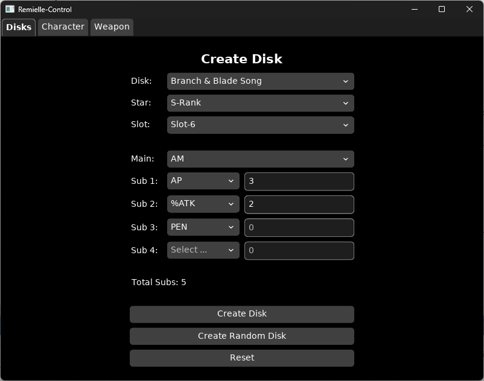
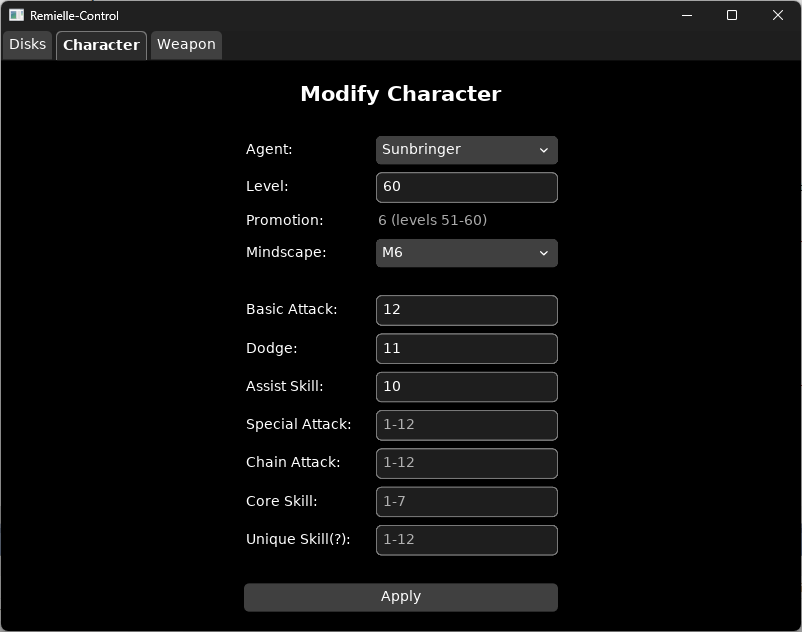
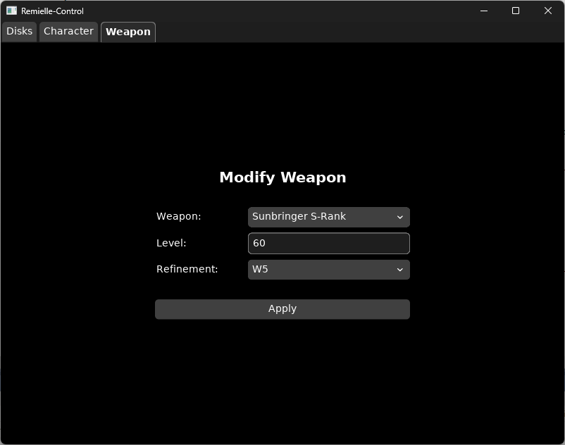

RemielleControl is a UI for the Remielle server for setting up Equipment/Characters, changing Deadly Assault stages and such.

# Requirements and Building from Source
To build RemielleControl from sources you need:
- Zig Compiler, version 0.16.0: [Linux](https://ziglang.org/download/0.16.0/zig-x86_64-linux-0.16.0.tar.xz)/[Windows](https://ziglang.org/download/0.16.0/zig-x86_64-windows-0.16.0.zip), or by using a [version manager](https://git.xeondev.com/nyan/zvm/releases)
- The game server: [Remielle](https://git.xeondev.com/remielle/remielle)

Check if your zig version matches:
```
$ zig version
0.16.0
```
If it matches, simply run
```zig build run```
Alternatively you can run
```zig build```
This will output an executable in the `zig-out/bin` directory.

The game server has to be running and you have to be logged in before running this program.

Currently supported beta: `CNBetaWin3.4.1`.

# Config
Configuration is done through the `config.zon` file
- `base_player_uid`: your in game UID
- `ctl_bind_address`: Address and port to the control interface of the server, default should work for most people

You will have to recompile (zig build) the program each time you change the config.

# Screenshots



